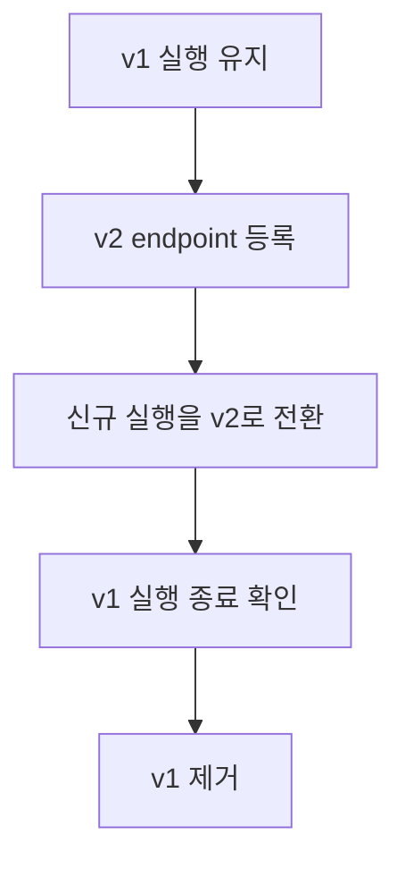
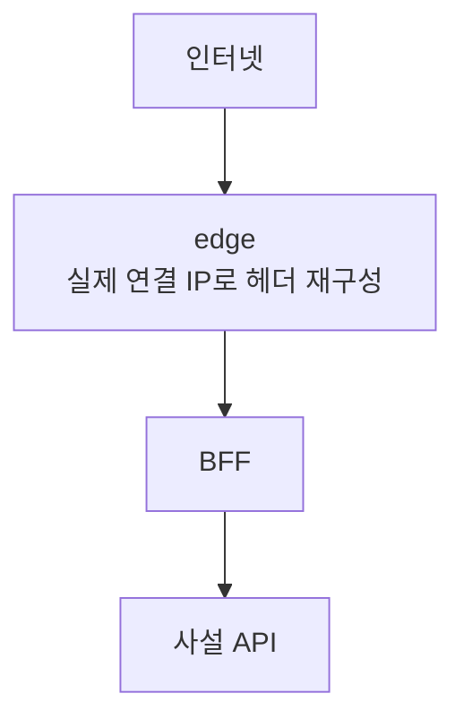

# apps/ — API와 연결 데모

`apps/api`는 이 시드의 중심이다. `web`은 사진 첨부 가입, 쿠키 인증과 본인 정보 조회를 보여 준다. 계층 구조와 NestJS 모듈 구성은 [API 가이드](api/README.md)에 있다.

## 시드의 범위

사용자 도메인으로 CRUD·인증을, 사진을 첨부한 가입으로 Application의 조합과 트랜잭션을 보여 준다. 기술 예제는 메시지 발행·수신과 문자열 변환 작업으로 나누어 도메인 없이 읽을 수 있게 한다. 관리 도구나 특정 업무의 전체 기능·장애 대응 정책은 제공하지 않는다.

핵심은 API와 재사용 라이브러리다. 데모는 API와의 연결 흐름을 보여 주는 범위로 유지한다. 새 계층이나 도구는 현재 요구사항을 해결하는 가치와 학습·실행·유지 비용을 비교해 도입한다. 작은 중복을 없애려고 범용 BFF나 인증 프레임워크를 만들지 않는다.

## 데이터와 DTO

각 모듈은 자기 collection의 읽기·쓰기를 담당한다. 다른 모듈의 Repository나 collection에 직접 접근해 join하지 않고 공개 서비스를 통해 협력한다. Users는 사진의 자산 ID만 보관하고 URL을 조회하지 않는다. WebHomeView가 로그인한 사용자 정보와 필요한 사진 URL만 조합한다.

HTTP에서 ID는 문자열로 전달하고, Repository가 ID 필터를 명시해 ObjectId로 변환한다. 서비스는 MongoDB 오류 번호나 ClientSession을 다루지 않는다. transaction으로 묶을 업무는 Application이 결정하고, 세션 생성·종료와 driver 실행은 common이 맡는다. `TransactionContext`는 콜백 안에서만 유효하다. 콜백은 재실행될 수 있으므로 외부 쓰기나 메시지 발행을 넣지 않는다.

HTTP 요청은 명시한 Zod 스키마로 검사·변환하고, 응답도 DTO 스키마로 정의한다. 내부 DB 모델 전체를 응답으로 내보내지 않는다. 달력 날짜는 `Temporal.PlainDate`, 특정 순간은 `Temporal.Instant`로 구분한다. 테스트 응답과 Restate의 JSON 데이터를 복원할 때도 같은 스키마를 사용하며 문자열 모양으로 날짜를 추측하지 않는다.

### 사진을 첨부한 회원가입

사진은 선택 사항이다. 첨부할 때는 업로드 조건 발급 → S3 전송 → 사진 ID를 포함한 가입 순서로 진행한다. 사진 전송에 실패한 web은 가입을 요청하지 않는다. API도 전송 완료 여부를 확인하고 사용자 생성과 사진 소유권 부여를 한 MongoDB transaction으로 확정한다. 첨부한 사진의 파일이 없거나 업로드가 만료됐거나 이미 다른 계정에 연결됐다면 계정을 만들지 않는다. 가입 응답 자체를 잃었을 때 같은 요청을 성공 응답으로 재생하는 기능은 제공하지 않는다.

사진은 1바이트부터 5 MiB까지 받으며 신고한 MIME은 `image/jpeg`·`image/png`·`image/webp`만 허용한다. 업로드 조건의 크기·Content-Type·체크섬이 다르거나 빠지면 S3가 거절한다. 파일 내용을 읽어 이미지 형식을 판별하거나 변환하지는 않는다. [사진 가입 API 예제](api/api-docs/registration-photo.spec)에서 전송 전 가입 실패와 전송 후 가입을 확인한다.

가입에 쓰지 않은 임시 사진과 실패한 파일 삭제는 10분마다 정리한다. 파일 삭제는 DB에 삭제 요청을 기록한 뒤 S3 객체와 자산 기록을 지운다. 실패하면 오류를 반환하고 재요청에 필요한 자산 기록을 유지한다. 이미 발급한 업로드 조건은 삭제로 취소되지 않으므로 삭제 시점부터 업로드 유효기간이 지난 뒤 객체를 한 번 더 지운다. 정리 실패는 다음 회차에서 다시 처리한다.

탈퇴는 사진 삭제 후 계정을 삭제한다. S3와 MongoDB를 하나의 transaction으로 묶지는 않는다. 사진 삭제 후 계정 삭제가 실패하면 같은 탈퇴 요청으로 마칠 수 있다.

### MongoDB와 원자성

문서 단위 모델과 공식 driver 사용을 보여 주기 위해 MongoDB를 선택했다. 모듈 사이의 관계를 공개 API로 관리하는 구조는 관계형 DB에서도 사용할 수 있다. 포크할 때 DB를 바꿀 가능성만으로 두 구현을 미리 유지하지 않는다.

개발 환경도 Replica Set이다. MongoDB의 다중 문서 transaction은 [Replica Set과 sharded cluster](https://www.mongodb.com/docs/manual/core/transactions-production-consideration/)에서 지원하고 standalone에서는 지원하지 않기 때문이다. unique index는 동시 중복 가입을, 자산의 조건부 갱신과 transaction은 사진 소유권 경쟁을 제어한다. DB를 바꿀 때는 쿼리뿐 아니라 이 동시성 계약도 검증해야 한다.

## 이벤트 예제

`POST /event-demo/messages`는 메시지를 JetStream에 저장하고 PubAck를 받은 뒤 `202`와 이벤트 ID를 반환한다. consumer는 메시지를 읽어 Core NATS로 전달한 다음 ack한다. 이때 전달 확인은 NATS 서버까지의 확인이며 브라우저의 수신 확인이 아니다. 전달 실패는 재시도하고 잘못된 메시지는 폐기한다.

각 API 복제본은 NATS를 구독해 본인 사용자 ID의 SSE 연결에 메시지를 보낸다. `GET /event-demo/event-stream`을 먼저 연결한 뒤 발행한다. 브라우저의 연결이 끊긴 동안 놓친 이벤트를 재생하지는 않는다. JetStream은 처리 전 메시지를 보존하지만 최종 SSE는 실시간 알림이다. 전달 후 ack 전에 중단되면 같은 이벤트 ID가 다시 올 수 있다.

## 비동기 작업 예제

`POST /job-demo/jobs`는 문자열을 받고 작업 기록을 만든 뒤 Restate에 제출한다. Restate 접수를 확인하면 `202`와 작업 ID를 반환한다. workflow는 문자열을 대문자로 바꾸고 변환한 문자열의 유니코드 코드포인트 수와 결과를 저장한다. `GET /job-demo/jobs/:jobId`는 본인의 작업만 조회하며 저장 전에는 `pending`, 저장 후에는 `completed`와 결과를 반환한다.

결과 저장의 일시 오류는 Restate가 재시도한다. journal에 기록한 step 결과는 재개 시 재사용하지만, 외부 쓰기 후 journal 기록 전에 중단되면 step이 다시 실행될 수 있다. 이 예제는 같은 작업에 같은 결과를 다시 저장해도 결과가 중복되지 않는다. HTTP 제출을 다시 보내면 별도 작업이 만들어진다. DB 기록과 Restate 접수는 하나의 transaction이 아니므로 접수 실패가 난 요청의 기록은 pending으로 남을 수 있으며 자동 재접수는 하지 않는다.

Restate를 사용해 단계별 실행 기록과 재시도를 보여 준다. 짧은 DB 쓰기를 함께 확정하는 MongoDB transaction과 역할이 다르다. BullMQ나 JetStream consumer로도 작업을 실행할 수 있지만 단계별 진행 기록은 직접 관리해야 한다. 이 저장소는 별도 worker bundle 없이 API에 Restate endpoint를 붙인다.

### 진행 중인 작업을 보존하는 배포

운영에서는 코드 버전(revision)마다 endpoint를 따로 등록하고, 진행 중인 작업(invocation)이 끝날 때까지 이전 코드를 유지해야 한다. [Restate의 deployment](https://docs.restate.dev/concepts/services/)는 새 작업과 진행 중인 작업이 각각 사용할 코드를 구분한다.

workflow step을 삭제하거나 순서를 바꾸면 이전 journal에 기록된 실행은 이전 코드로 끝내야 한다. 같은 endpoint에 새 코드를 덮어쓰면 실행을 재개할 때 step 순서가 맞지 않을 수 있다. 새 DB 문서에서 필드를 없애는 것과 기존 journal의 실행 코드를 교체하는 것은 별도로 검토해야 한다.

개발용 force 재등록이나 테스트의 고정 NGINX URI를 운영 무중단 배포 방식으로 복사하지 않는다. 개발 reset은 journal까지 삭제하므로 보존할 실행이 없는 환경에서만 사용한다.

## HTTP와 인증 계약

가입·사진 업로드·로그인은 공개 경로다. `/users/me`, 홈, 이벤트와 작업 예제는 사용자 인증을 요구하며 사용자 ID는 토큰의 subject로 결정한다.

사용자의 비밀번호는 생성·변경·로그인 모두 15~128개의 유니코드 코드포인트로 제한한다. `가`와 `🌱`는 각각 하나이며 결합된 이모지는 여러 코드포인트일 수 있다. 공백도 문자로 허용하고 원문을 자르거나 trim·정규화하지 않으며, 대소문자·숫자·특수문자 조합을 강제하지 않는다. 길이는 앱의 입력 정책이고 HTTP 본문 크기 제한이나 Argon2id 해시 함수의 제한이 아니다. 가입·로그인 화면에도 같은 기준을 적용한다.

이메일은 앞뒤 공백을 제거하고 전체를 소문자로 바꾼 뒤 형식을 검사한다. 가입·변경·로그인에 같은 규칙을 적용하며, 정규화한 이메일과 `deletedAt`의 unique index로 동시 중복도 막는다. 점과 `+`태그는 제거하지 않는다. 탈퇴 후 같은 이메일로 재가입할 수 있다. 이 시드는 이전 규칙으로 저장된 이메일이나 비밀번호를 자동 변환하지 않는다.

액세스 JWT 인증에서는 서명·만료·issuer/audience·필수 claim을 검사하며 계정·토큰 DB를 조회하지 않는다. 유효 기간은 5분이며 로그아웃·비밀번호 변경·계정 삭제로도 이미 발급한 액세스 권한을 즉시 회수하지 않는다. 삭제된 계정의 `/me` 요청은 인증을 통과한 뒤 자원 조회에서 404가 될 수 있다.

리프레시 토큰은 로그인 세션별로 현재 토큰의 해시를 Redis에 저장하고 원자적으로 교체한다. 교체된 과거 토큰을 사용하면 409를 반환하고 현재 세션은 유지한다. 로그아웃은 해당 세션을, 전체 로그아웃은 회수 시 조회한 세션을 제거한다. 조회 후 새 로그인으로 추가된 세션은 유지한다. 토큰의 교체 이력을 추적하거나 이메일별로 로그인을 잠그지는 않는다.

로그인은 비밀번호 검증에 사용한 계정의 `authVersion`을 토큰에 담는다. 사용자 비밀번호를 변경할 때 MongoDB의 같은 쓰기에서 인증 버전을 증가시키고, refresh는 현재 계정이 존재하며 버전이 일치할 때만 허용한다. 계정이 삭제됐거나 버전이 없거나 다르면 401을 반환한다. 계정 DB 조회가 실패하면 갱신도 실패하며 Redis의 토큰을 교체하지 않는다. 인증 버전은 refresh에 적용하며 이미 발급한 액세스 권한을 즉시 회수하지 않는다.

비밀번호 변경·계정 삭제는 DB 반영 뒤 Redis 세션도 제거한다. 이 정리에 실패하면 요청은 오류를 반환하고 DB 변경은 유지되지만, 이전 인증 버전이나 삭제된 계정의 토큰으로는 refresh할 수 없다. 비밀번호 검증 후 변경·삭제와 경합한 로그인이 늦게 토큰을 발급해도 같은 검사를 받는다.

로그인 실패는 IP별로 제한하며 로그인에 성공해도 실패 횟수를 초기화하지 않는다. `/me`는 본인의 자원만 다룬다.

## 통합 테스트와 실행 가능한 API 문서

API 테스트는 실제 Nest 앱과 MongoDB·Redis·S3·NATS·Restate에 연결한다. worker별 DB·bucket과 테스트별 PROJECT_ID로 자원을 구분하며, 같은 API Vitest 명령의 동시 실행은 지원하지 않는다.

모듈 최상위에서 읽은 `process.env` 값은 import 시점에 고정된다. 따라서 테스트마다 달라지는 prefix·subject·workflow 이름은 provider를 만들 때 주입한 설정으로 결정한다. workflow 테스트는 `enableRestate: true`로 endpoint를 등록하고, 작업 종료 후 정리 단계에서 등록을 제거한다. 다른 테스트에서는 의도하지 않은 workflow 제출을 거절한다.

접수 202, DB 생성, 이벤트 전달은 서로 다른 결과다. DB 결과는 작업이 끝난 후 다시 조회하고, SSE 자체를 검증할 때는 구독을 준비한 뒤 요청한다. 테스트 작성은 [테스트 작성 규칙](../tests/README.md#테스트는-한-행동의-결과를-검증한다), 여러 프로세스의 검증은 [tests](../tests/README.md)를 따른다.

`api-docs/*.spec`는 bash·curl로 주요 요청 흐름을 실행한다. `TEST`는 설명과 기대 HTTP 상태를 정의하는 문서 항목이고, `SETUP`은 그 조건을 준비하는 요청이다. SSE와 세부 장애 조건까지 curl 문서에 복제하지 않는다. 실행 방법과 결과 위치는 [README](../README.md#실행과-검증)를 참고한다.

`common.fixture`의 `login_user`는 이후 요청에 인증 헤더를 넣고, `as_guest`는 자동 주입을 해제한다. spec에 Authorization을 명시하면 그 값이 우선한다. 직접 실행할 때는 api-docs의 `.env`에서 지정한 서버를, 외부 검증 스택에서는 runner가 지정한 SERVER_URL을 사용한다.

`scripts/`는 API 소스와 별도로 실행한다. Restate 개발 등록 도구는 common 빌드 없이 필요한 SDK를 직접 사용한다.

## 데모와 BFF

web은 선택한 사진 업로드·가입·로그인·본인 정보 조회를 보여 준다. API View는 화면 응답을 조합한다. web의 BFF는 브라우저와 API 사이에서 쿠키와 요청 전달을 맡는 Next.js Route Handler다.

BFF는 액세스·리프레시 토큰을 HttpOnly 쿠키에 보관하고 각 JWT의 exp에 맞춰 쿠키를 만료시킨다. 액세스 인증에 실패하면 토큰을 갱신한 뒤 원 요청을 한 번 재시도한다. 같은 프로세스에서 같은 리프레시 토큰으로 동시에 갱신을 요청하면 하나로 합치고 결과를 짧게 공유한다. 다른 프로세스가 먼저 토큰을 교체해 409를 받더라도 쿠키를 지우지 않는다. 원 요청 재시도가 실패해도 이미 발급받은 새 쿠키는 보관한다.

인증 경로는 API와 같이 대소문자를 구분하지 않고 판별하며, 일반 자원 경로는 원문대로 전달한다. 로그인·로그아웃으로 인한 쿠키 설정·삭제는 사용자 인증 경로의 POST 요청에만 적용한다. 인증 경로의 POST 외 요청과 외부에서 직접 요청한 refresh 경로는 404로 거절한다.

로그아웃 요청이 BFF에 도달하지 않으면 쿠키도 유지된다. BFF가 API 로그아웃을 요청한 뒤에는 API 실패 때도 브라우저 쿠키를 지우지만, 이 응답을 성공한 서버 세션 폐기로 표시하지 않는다.

최초 요청이나 토큰 갱신 후 재시도에서 API 응답을 받기 전에 fetch가 실패하면 BFF는 `502` JSON 오류를 반환한다. 브라우저가 다른 API 오류와 같은 응답 형식으로 실패를 표시할 수 있게 하기 위해서다.

API 프록시는 요청 본문의 크기를 제한하고, 상태를 변경하는 요청의 Origin/Host를 확인한다. 최종 인가는 API guard가 판단한다. frontend의 API_BASE_URL은 API_PORT와 자동 연동되지 않는다. frontend 포트를 바꿀 때도 Compose·tunnel·포트 전달 설정을 함께 맞춰야 한다.

BFF는 기본적으로 전달된 IP 헤더를 신뢰하지 않는다. 이때 API에는 BFF의 주소가 보이므로 여러 사용자의 로그인 실패 횟수가 같은 IP로 집계될 수 있다. 운영에서 `BFF_TRUST_PROXY_HEADERS=true`를 사용하려면 다음 구조가 필요하다.

edge를 우회해 origin(BFF 서버)과 API에 직접 접근하지 못하게 해야 한다. edge는 X-Forwarded-For의 오른쪽 끝과 X-Real-IP를 실제 연결 주소로 덮어써야 한다. BFF는 오른쪽 끝값을 사용하며, 그 값이 잘못돼도 앞쪽 주소로 대체하지 않는다. 운영 모드의 쿠키에는 Secure가 기본으로 켜진다. HTTP로 실행하는 [web 테스트](../tests/README.md)는 이 조건의 일부만 모사한다.

사진의 presigned URL은 Docker 내부 S3 주소를 사용한다. web의 `/storage/*` Route Handler는 `S3_ENDPOINT`로 업로드·다운로드를 전달하며 서명 검증은 S3가 맡는다. 파일은 API의 JSON 프록시를 통과하지 않는다. 브라우저는 Web Crypto로 체크섬을 계산하므로 HTTPS 또는 localhost에서 실행한다.

API의 production build는 Rspack으로 앱 코드를 묶고, common 등 런타임 패키지는 번들에 넣지 않고 별도로 배포한다. 개발 중 변경을 감지하는 watch 모드는 TSC를 사용한다. Restate endpoint는 API 안에서 함께 실행하므로 별도 worker bundle은 두지 않는다.

## 추가하지 않은 도구

| 도구                      | 현재 선택의 이유                                                                                    |
| ------------------------- | --------------------------------------------------------------------------------------------------- |
| OpenAPI / Swagger         | 주요 흐름은 실행 가능한 curl 문서로 동작과 함께 검증한다. 별도 카탈로그·SDK 생성은 요구하지 않는다. |
| Passport                  | 현재 사용자 인증은 Nest Guard로 간단히 구현할 수 있다.                                              |
| Nx / Turborepo            | 현재 workspace 실행은 pnpm으로 충분하며 별도 작업 의존성 관리나 캐시가 필요하지 않다.               |
| GraphQL                   | 홈 화면 한 응답은 View로 조합할 수 있어 별도 schema·resolver 체계를 넣지 않는다.                    |
| pino                      | 현재 로거를 교체해야 할 처리량 병목은 확인되지 않았다.                                              |
| Service Mesh·관측 backend | 운영 플랫폼은 실제 배포 환경에 맞춰 선택한다.                                                       |
