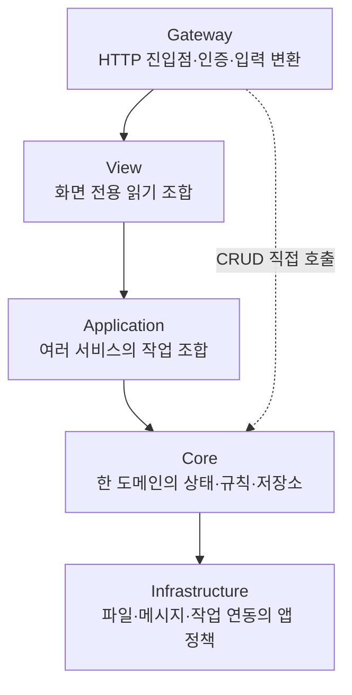

# API — 서비스 구성과 작성 규칙

## SoLA의 모듈 의존 방향

모듈은 하위 계층에만 의존한다. 여러 모듈을 조합하는 서비스는 그보다 상위 계층에 둔다. Service·Repository·모델·DTO는 해당 모듈에 함께 둔다. [서비스 모듈](src/services/)

사진을 첨부한 가입은 계정 생성과 사진 소유권 등록을 함께 처리하므로 Application의 UserRegistration이 맡는다. View의 WebHomeView는 저장된 사진 ID로 URL을 조회해 홈 응답을 만든다. View는 읽기 전용이며 상태 변경은 Application·Core가 맡는다.

### Gateway와 모듈 공개 진입점

컨트롤러는 `services/gateway`에 두고 `AppModule`에 등록한다. 가입을 처리하는 `UsersHttpController`를 UsersModule에 두면 Users → UserRegistration → Users 순환이 생긴다. UsersModule을 import하는 것만으로는 HTTP 경로가 등록되지 않는다.

다른 모듈은 공개 `index.ts`로 참조한다. `internal/`·`worker/`는 비공개로 두고 workflow 정의처럼 앱 조립에 필요한 항목만 공개한다. 모듈 내부에서는 상대 경로로 직접 import한다. 테스트도 비공개 구현 자체를 검증할 때만 내부 파일을 참조한다.

루트 Oxlint가 계층과 import 방향을 검사한다. [공유 패키지의 SDK 사용 규칙](../../libs/README.md#2-sdk-연결과-호출은-common에서-구현한다) · [TypeScript 표기](../../libs/README.md#7-typescript-작성-규칙)

## 데이터와 트랜잭션

모듈은 자신의 컬렉션만 읽고 쓴다. 다른 모듈의 데이터는 공개 서비스를 통해 다룬다. 쿼리·인덱스·DB 오류 변환은 Repository가, 연결과 드라이버 호출은 common이 맡는다.

여러 모듈을 묶는 트랜잭션은 Application이 정한다. `TransactionContext`는 콜백 안에서만 유효하다. 콜백이 재실행될 수 있으므로 S3 쓰기와 메시지 발행은 콜백 밖에서 한다. [저장소 계약](../../libs/README.md#3-저장소-id와-트랜잭션)

### DTO와 JSON

요청·응답과 JSON에서 복원할 데이터는 Zod 스키마로 정의한다. 응답 DTO는 DB 모델과 구분한다. 이름에는 동작과 대상을 드러내고 스키마는 `Schema`, `z.infer`로 얻은 타입은 `Dto`로 끝낸다. [CreateUserSchema](src/services/core/users/dtos/create-user.dto.ts)

JSON 본문은 선언한 타입으로 받고, 숫자 쿼리나 날짜처럼 변환이 필요한 필드만 지정한다. 수정할 필드를 생략하면 기존 값을 유지한다. `null`은 모델이 허용할 때만 받는다. [JSON과 DTO 복원](../../libs/README.md#4-json과-dto-복원)

## 서비스 이름과 조회 계약

Core 서비스는 엔티티 집합(`UsersService`), Application 서비스는 유스케이스(`UserRegistrationService`)로 이름 짓는다. 조회 조건은 `find({ email })`처럼 객체로 받는다. 인증용 조회처럼 반환 목적이 다르면 `findForAuthentication`처럼 이름으로 구분한다.

| 이름                    | 계약                                             |
| ----------------------- | ------------------------------------------------ |
| `find` / `findMany`     | 없으면 null / 찾은 결과만 배열로 반환            |
| `get` / `getMany`       | 요청한 대상 중 하나라도 없으면 NotFoundException |
| `search` / `searchPage` | 조건 검색 / 페이지 정보를 포함한 검색            |

일반 조회·삭제는 단건과 여러 건에 같은 서비스 메서드를 사용한다.

## 오류와 실행 설정

Core·Application도 NestJS DI와 `HttpException`을 사용한다. 예상한 오류는 해당 모듈의 `errors.ts`에 정의하고 조건을 판단한 곳에서 던진다. 클라이언트가 구분해야 하는 4xx 응답에는 `code`를 넣고, 5xx의 내부 원인은 서버 로그에만 남긴다.

환경마다 달라지는 값은 env에 두고 부팅 시 검증한다. 화면 조회 개수 같은 고정값은 사용하는 코드에 둔다.

개발 서버는 TSC, 배포 빌드는 Rspack을 쓴다. common 등 런타임 패키지는 번들 밖에 있으므로 앱과 함께 배포한다. [컨테이너 빌드](Dockerfile) · [실행 설정](compose.yml)

API 로그는 stdout/stderr에 ECS JSON으로 출력한다. 요청·응답 본문과 쿼리는 기록하지 않는다.

## 테스트

단순 위임은 실제 Nest 모듈과 개발 인프라를 연결한 통합 테스트에서 확인한다. 독립적인 계산·변환은 단위 테스트로 검증할 수 있다. [테스트 작성 규칙](../../tests/README.md#테스트는-한-행동의-결과를-검증한다)

`createAppTestContext`와 공통 훅이 앱을 준비하고 정리한다. 데이터 준비·조회·장애 주입 함수는 해당 `*.utils.ts`에 둔다. DB와 버킷은 worker별로, `PROJECT_ID`는 테스트별로 나누므로 키 접두어·subject·workflow 이름은 provider에 주입된 설정으로 정한다.

API 서버와 통합 테스트는 `configureHttpApp`으로 HTTP 설정을 적용한다. 테스트에 경로 접두어 같은 설정이 더 필요하면 `createAppTestContext({ configureApp })`으로 전달한다. 이 콜백은 공통 설정을 적용한 뒤 Nest가 경로를 등록하기 전에 실행된다. [HTTP 설정](src/bootstrap.ts)

모든 API 통합 테스트에서 실제 Restate를 사용한다. `beforeEach`에서 앱을 준비할 때 workflow 리스너에 배정된 포트로 `RESTATE_DEPLOYMENT_URI`를 설정하면 API가 운영과 같은 절차로 등록한다. `teardown`은 제출한 작업이 끝난 뒤 그 테스트의 등록을 해제하고 앱을 닫는다. [배포 환경의 주소 설정](../../infra/README.md#4-restate에-workflow-실행-주소-등록) · [비동기 작업 테스트](src/__tests__/infrastructure/job-demo.spec.ts) · [SSE 수신 테스트 작성법](../../libs/README.md#5-sse-이벤트를-받는-테스트-작성)

### 실행 가능한 API 문서

외부에 `api-docs/`를 전달하기 전에 `run.cfg`의 API 주소를 수정한다. 전달받은 사람은 그 폴더에서 `bash run.sh`를 실행한다.
