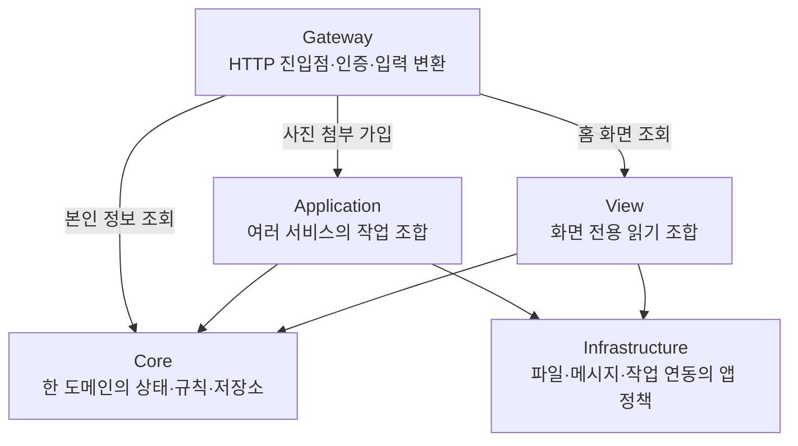

# API

## SoLA의 모듈 의존 방향

SoLA(Service-oriented Layered Architecture)에서는 한 도메인의 Service·Repository·모델·DTO를 한 모듈에 둔다. 상위 계층은 필요한 하위 계층을 직접 호출할 수 있다. 같은 계층의 두 도메인이 협력해야 하면 상위 계층에서 조합한다.



### 어디에 책임을 둘까

- **본인 정보 조회**에는 사용자 도메인의 데이터만 필요하므로 Gateway가 Core의 `UsersService`를 호출한다. 이메일 중복 판정도 사용자를 생성하는 도메인에서 맡는다. [사용자 컨트롤러](src/services/gateway/users.http-controller.ts) · [사용자 저장소](src/services/core/users/users.repository.ts)
- **사진 첨부 가입**은 계정과 사진 소유권을 함께 저장해야 하므로 Application에 둔다. 가입 서비스는 업로드 완료를 확인하고 `users.create`와 `assets.finalizeUpload`에 같은 트랜잭션을 전달한다. 사진 소유권 등록이 실패하면 계정 생성도 롤백된다. [가입 서비스](src/services/application/user-registration/user-registration.service.ts) · [동시 가입과 롤백 테스트](src/__tests__/application/user-registration.spec.ts)
- **홈 화면 조회**는 계정 정보와 사진 다운로드 URL을 화면에 맞게 조합하므로 View에 둔다. 업로드 완료 판정과 소유권 부여는 앱의 정책이므로 Infrastructure가 맡고, S3 요청 서명은 여러 앱이 공유하는 common이 맡는다. [홈 화면 조회](src/services/view/web/home/home-view.service.ts) · [자산 서비스](src/services/infrastructure/assets/assets.service.ts)

Gateway 컨트롤러는 `AppModule`에 등록한다. 예를 들어 사용자 컨트롤러를 `UsersModule`에 등록하면 `Users → UserRegistration → Users` 순환 의존이 생긴다. 다른 모듈에서는 공개 진입점(`index.ts`)을 통해 서비스를 가져온다. 루트의 `pnpm run lint:code`가 계층 역참조와 비공개 모듈 접근을 검사한다. [앱 모듈 조립](src/app.module.ts) · [의존 방향 검사](../../oxlint.config.mts)

### 데이터와 서비스 계약

각 모듈이 자신의 컬렉션을 읽고 쓴다. 쿼리·인덱스와 고유 키 충돌 처리는 Repository에 두고, 다른 모듈에는 서비스를 공개한다. 조회 메서드에서 `find`는 대상이 없으면 `null`, `findMany`는 찾은 대상만 반환한다. `get`과 `getMany`는 요청한 대상 중 하나라도 없으면 `NotFoundException`을 던진다. [사용자 저장소](src/services/core/users/users.repository.ts) · [공유 저장소의 트랜잭션 계약](../../libs/README.md#저장소와-트랜잭션)

HTTP 입력은 Zod 스키마로 검증하고 DTO 타입은 스키마에서 추론한다. 수정 요청에서 생략한 필드는 보존하고 `null`은 스키마가 허용할 때만 받는다. [사용자 수정 DTO](src/services/core/users/dtos/update-user.dto.ts)

사진 업로드 응답의 `expiresAt`은 S3 업로드 기한과 가입 시 사진 소유권을 확정할 기한 중 이른 시각이다. [사진 업로드 발급](src/services/infrastructure/assets/assets.service.ts)

클라이언트가 구분할 4xx 응답에는 `code`를 포함하고, 5xx의 내부 원인은 서버 로그에 남긴다. [HTTP 오류 응답과 로그](../../libs/common/src/logger/__tests__/exception-logger.filter.spec.ts)

### 이벤트와 비동기 작업

이벤트 발행의 202는 JetStream이 메시지를 접수했다는 뜻이다. 발행한 사용자가 SSE에서 같은 이벤트 ID를 다시 받을 수 있다. 작업 제출의 202는 Restate가 작업을 접수했다는 뜻이며, 제출한 사용자는 `GET /job-demo/jobs/{jobId}`에서 진행 상태와 결과를 조회한다. [이벤트 수신 테스트](src/__tests__/infrastructure/event-demo.spec.ts) · [작업 제출·조회 예제](api-docs/job-demo.spec)

`RESTATE_DEPLOYMENT_URI`에는 Restate가 접근할 workflow 주소를 지정한다. 같은 버전의 API 복제본은 주소 하나를 공유한다. 새 버전을 별도 주소에 등록하고 기존 작업이 끝날 때까지 이전 주소에서 이전 코드를 실행해야 진행 중인 작업을 복구할 수 있다. [복제본 설정](../../infra/compose.yml) · [재시작 후 복구 검증](../../infra/tests/restate-journal-recovery.test.js)

## 테스트

API 동작은 `src/__tests__/`의 Vitest 통합 테스트에 작성한다. `#test-helpers`의 `createAppTestContext()`로 실제 Nest 앱과 인프라를 연결하고 `afterEach`에서 `fix.teardown()`으로 닫는다. DB와 버킷은 worker별로, `PROJECT_ID`는 테스트별로 할당되므로 자원 이름은 주입된 설정에서 얻는다. [테스트 앱](src/__tests__/helpers/create-app-test-context.ts) · [테스트 작성 규칙과 예제](../../AGENTS.md#테스트는-한-행동의-결과를-검증한다)

가입한 비밀번호로 로그인할 수 있는지는 두 HTTP 요청으로 검증한다. [사용자 통합 테스트](src/__tests__/core/users.spec.ts)

```ts
await fix.httpClient.post('/users').body(createDto).created({ schema: UserSchema })
await fix.httpClient.post('/users/login').body({ email: createDto.email, password }).ok()
```

### 실행 가능한 API 문서

`api-docs/`의 curl 예제는 전체 묶음으로 요청 순서와 HTTP 상태를 검증한다. 개발 API가 실행 중이면 저장소 루트에서 `bash apps/api/api-docs/run.sh`를 실행한다. 요청별 기대·실제 상태는 `apps/api/api-docs/_output/docs/summary.md`에 기록된다.

예제를 전달할 때는 루트에서 `bash apps/api/pack-api-docs.sh > /tmp/api-docs.tar.gz`로 묶는다. 받은 사람은 Bash·curl·jq가 설치된 Linux에서 압축을 풀고 그 폴더에서 실행한다. 사진 예제는 API가 발급한 S3 주소에도 접근할 수 있어야 한다. [회원가입 예제](api-docs/users.spec)

```bash
SERVER_URL=https://api.example.com bash run.sh
```
