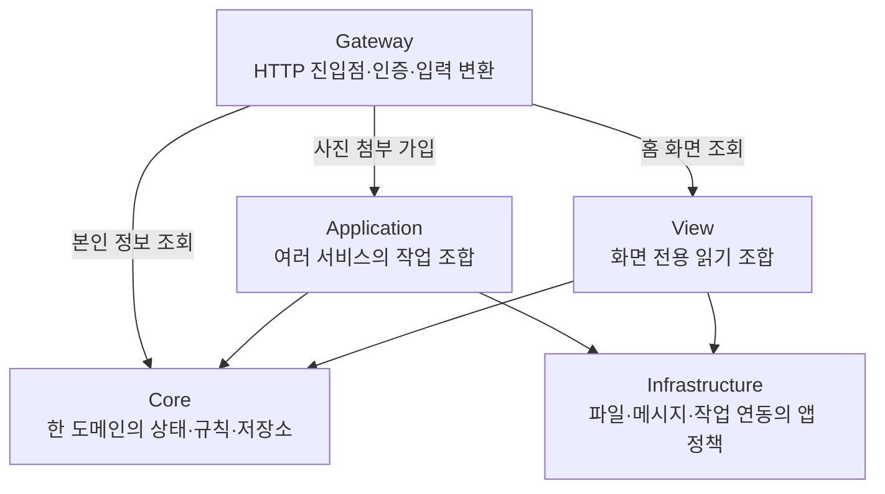

# API — 서비스 구성과 작성 규칙

## SoLA의 모듈 의존 방향

SoLA(Service-oriented Layered Architecture)는 하나의 API 안에서 모듈의 책임과 의존 방향을 정하는 설계 규약이다. 한 도메인의 상태와 규칙은 한곳에 모으고 Service·Repository·모델·DTO를 해당 모듈에 함께 둔다. 사용자 계정 규칙을 고칠 때 가입 화면이나 홈 화면이 그 규칙을 어떻게 쓰는지까지 알 필요가 없다.

의존은 `Gateway → View → Application → Core → Infrastructure` 순서에서 아래쪽으로 향한다. 필요한 하위 계층을 직접 쓸 수 있다. 같은 계층의 두 도메인이 협력해야 하면 둘을 조합하는 책임을 상위 계층에 둔다. 서로의 서비스를 다시 호출하는 순환을 피하면서 두 도메인을 다른 기능에서도 독립적으로 쓸 수 있다.

### 어디에 책임을 둘까

- **본인 정보 조회**에서 Gateway는 인증된 사용자의 ID를 얻어 Core에 전달한다. 계정 정보는 사용자 도메인 하나가 소유하므로 Core 호출만으로 응답을 만들 수 있다. 이메일 중복처럼 다른 진입점에서도 지켜야 할 계정 규칙은 사용자 모듈에서 판단한다. [사용자 API](src/services/gateway/users.http-controller.ts) · [사용자 저장소](src/services/core/users/users.repository.ts)
- **사진 첨부 가입**에서 Core는 계정을 만들고 Infrastructure의 자산 모듈은 업로드 상태와 사진 소유권을 관리한다. “가입에 실패했는데 계정만 남는 일”을 막을 책임은 두 모듈을 함께 쓰는 Application에 있다. 업로드 완료를 먼저 확인한 뒤 계정 생성과 사진 소유권 등록을 한 DB 트랜잭션에 넣는다. 같은 사진으로 두 사람이 가입하거나 소유권 저장이 실패해도 일관성을 지켜야 한다. [가입 서비스](src/services/application/user-registration/user-registration.service.ts) · [동시 가입과 롤백 테스트](src/__tests__/application/user-registration.spec.ts)
- **홈 화면 조회**는 사용자의 사진 ID를 읽고 자산 모듈에서 다운로드 URL을 얻어 화면용 응답을 만든다. 이 조합을 View에 두면 홈의 표시 요건이 변해도 사용자 도메인의 조회 계약을 유지할 수 있다. 화면을 여는 동작에 상태 변경까지 필요해지면 그 변경은 Core나 Application의 유스케이스로 정의한다. [홈 화면 조회](src/services/view/web/home/home-view.service.ts)

Infrastructure에는 업로드 완료 판정·소유권 부여처럼 외부 시스템을 사용하는 **이 앱의 정책**을 둔다. S3 요청에 서명하는 기능처럼 여러 앱이 그대로 쓸 SDK 연동은 common이 맡는다. 이 구분 덕분에 같은 저장소 클라이언트를 쓰는 앱마다 파일 사용 규칙을 따로 정할 수 있다. [자산 서비스](src/services/infrastructure/assets/assets.service.ts) · [공유 패키지의 책임](../../libs/README.md#2-sdk-연결과-호출은-common에서-구현한다)

### Gateway와 모듈 공개 진입점

이 프로젝트는 먼저 외부에 제공할 HTTP 동작을 정하고, 구현할 책임을 서비스로 나눈다. 그래서 같은 사용자 API의 URL·입력 검증·인증을 Gateway의 한 컨트롤러에서 읽을 수 있다. 본인 조회는 사용자 서비스로, 사진 가입은 가입 서비스로 이어진다. 컨트롤러를 UsersModule에 넣으면 가입 서비스를 쓰기 위해 Users → UserRegistration → Users 순환이 생긴다. `AppModule`에서 도메인 HTTP 컨트롤러를 등록하면 다른 모듈은 UsersModule의 서비스만 가져다 쓸 수 있다. [사용자 컨트롤러](src/services/gateway/users.http-controller.ts) · [앱 모듈 조립](src/app.module.ts)

다른 모듈에는 `index.ts`로 필요한 항목만 공개한다. worker의 구현도 앱 조립에 필요한 workflow 정의만 이 진입점으로 내보낸다. 같은 모듈 안에서는 상대 경로를 사용한다. 자신을 다시 내보내는 진입점을 거치면 모듈 내부에서도 순환 참조가 생길 수 있다.

루트의 `pnpm run lint:code`는 계층 역참조와 다른 모듈의 비공개 파일 import를 검사한다. 설계 리뷰에서는 View가 하위 서비스의 쓰기 메서드를 호출하는지, 가입 실패 시 함께 되돌려야 할 변경이 같은 트랜잭션 안에 있는지를 살핀다. 허용된 방향으로 import한 코드에서도 두 문제가 생길 수 있다. [의존 방향과 테스트 예외를 검사하는 설정](../../oxlint.config.mts)

## 데이터와 서비스 계약

모듈은 자신의 컬렉션을 읽고 쓰며 다른 모듈의 데이터는 공개 서비스를 통해 다룬다. 쿼리·인덱스와 고유 키 충돌을 도메인 오류로 바꾸는 책임은 Repository에 둔다. 여러 Repository의 쓰기를 묶을 때는 같은 트랜잭션 context를 전달한다. [저장소와 트랜잭션 계약](../../libs/README.md#3-저장소-id와-트랜잭션)

Core 서비스는 `UsersService`처럼 엔티티 집합으로, Application 서비스는 `UserRegistrationService`처럼 유스케이스로 이름 짓는다. 조회 조건은 `findForAuthentication({ email })`처럼 객체로 받고, 이름에는 반환 목적을 드러낸다. 일반 조회·삭제는 단건도 다건 서비스 메서드를 사용하므로 호출 대상이 늘어도 같은 계약을 쓸 수 있다. [사용자 서비스](src/services/core/users/users.service.ts) · [인증용 조회](src/services/core/users/users.repository.ts)

| 조회 메서드를 지을 때   | 호출자가 기대하는 결과                           |
| ----------------------- | ------------------------------------------------ |
| `find` / `findMany`     | 대상이 없으면 null / 찾은 대상만 배열로 반환     |
| `get` / `getMany`       | 요청한 대상 중 하나라도 없으면 NotFoundException |
| `search` / `searchPage` | 조건 검색 결과 / 페이지 정보가 포함된 결과       |

요청·응답 DTO는 DB 모델과 구분한다. 네트워크를 건넌 값은 런타임 검증과 타입 복원이 필요하므로 Zod 스키마에서 TypeScript 타입도 추론한다. 스키마는 `Schema`, 타입은 `Dto`로 끝낸다. JSON 본문은 선언한 타입으로 받고 숫자 쿼리나 날짜처럼 필요한 필드만 변환한다. 수정 요청이 생략한 필드는 기존 값을 유지하며 `null`은 모델이 허용할 때만 받는다. [생성과 수정 스키마](src/services/core/users/dtos/) · [JSON 값 복원](../../libs/README.md#4-json과-dto-복원) · [TypeScript 표기](../../libs/README.md#7-typescript-작성-규칙)

### 이벤트와 비동기 작업의 완료 기준

이벤트 발행의 202는 JetStream이 메시지를 접수했다는 뜻이다. 발행한 사용자의 열린 SSE 연결로 이벤트를 보낸다. 메시지가 재전달되면 같은 이벤트 ID가 다시 올 수 있다. 비동기 작업의 202는 Restate가 작업을 접수했다는 뜻이다. 호출자는 연결을 닫아도 반환된 작업 ID로 본인의 진행 상태와 저장된 결과를 나중에 조회할 수 있다. [이벤트 발행과 수신 테스트](src/__tests__/infrastructure/event-demo.spec.ts) · [작업 제출·조회 예제](api-docs/job-demo.spec)

## 오류와 실행 설정

Core·Application도 NestJS DI와 `HttpException`을 사용한다. 예상한 오류는 해당 모듈의 `errors.ts`에 정의하고 조건을 판단한 곳에서 던진다. 클라이언트가 구분할 4xx 응답에는 `code`를 넣고, 5xx 내부 원인은 서버 로그에 남긴다. HTTP 로그는 stdout/stderr에 ECS JSON으로 출력하며 요청·응답 본문과 쿼리를 제외한다. [HTTP 예외 로깅 테스트](../../libs/common/src/logger/__tests__/exception-logger.filter.spec.ts)

환경마다 달라지는 값은 부팅할 때 검증하고 화면 조회 개수 같은 고정값은 사용하는 코드에 둔다. 배포할 때는 번들 밖의 common 등 런타임 의존성도 함께 설치한다. 준비 상태에는 이벤트 전달도 포함되므로 NATS에 연결되어 있어도 JetStream 소비자가 멈추면 `/health`가 503을 반환한다. [컨테이너 빌드](Dockerfile) · [기동·장애 응답 테스트](src/__tests__/health.spec.ts)

## 테스트

API 통합 테스트는 `createAppTestContext`로 실제 Nest 모듈과 테스트 실행을 위해 초기화한 인프라를 연결한다. 공통 훅이 worker별 DB·버킷과 테스트별 `PROJECT_ID`를 준비하므로 키 접두어·subject·workflow 이름은 주입된 설정에서 얻는다. 데이터 준비·조회·장애 주입 함수는 해당 `*.utils.ts`에 둔다. 독립적인 계산·변환은 단위 테스트로 검증할 수 있다. [공통 훅](vitest.setup.ts) · [테스트 작성 규칙](../../AGENTS.md#테스트는-한-행동의-결과를-검증한다) · [복제본 검증](../../README.md#앱-컨테이너와-복제본-검증)

실제 서버와 같은 HTTP 설정을 쓰며, 경로 접두어 같은 설정이 더 필요하면 `createAppTestContext({ configureApp })`에서 경로 등록 전에 적용한다. `teardown()`은 제출한 작업의 완료를 확인한 뒤 테스트용 Restate 배포를 해제한다. 완료를 확인할 수 없으면 배포를 보존하고 앱을 닫은 뒤 오류를 전달한다. [테스트 앱 생성·정리](src/__tests__/helpers/create-app-test-context.ts) · [비동기 작업 테스트](src/__tests__/infrastructure/job-demo.spec.ts) · [SSE 구독 준비](../../libs/README.md#5-sse-이벤트를-받는-테스트-작성)

### 실행 가능한 API 문서

외부에 예제를 전달할 때는 저장소 루트에서 `bash apps/api/pack-api-docs.sh > /tmp/api-docs.tar.gz`를 실행한다. 압축 파일에는 실행기와 예제·fixture·사진이 들어간다. 로컬 실행에서 받은 응답 본문은 `_output/`에 저장되므로 배포본에서 제외한다. CI도 이 압축을 풀어 배포용 API 이미지에 요청을 보낸다. [배포본 검증](api-docs/test.sh)

받은 사람은 Bash·curl·jq가 설치된 Linux 환경에서 압축을 풀고, 그 폴더에서 대상 API 주소를 `SERVER_URL`로 지정해 `bash run.sh`를 실행한다. `bash run.sh users.spec`는 회원가입 예제만 실행한다. 사진 예제는 발급받은 S3 주소로 직접 업로드하므로 실행 환경에서 그 주소에도 접속할 수 있어야 한다. [주소 지정 예시](api-docs/run.cfg) · [회원가입 요청과 기대 응답](api-docs/users.spec)

실행기가 출력한 보고서에는 그때 선택한 예제와 요청별 기대·실제 HTTP 상태가 남는다. 연결이 끊기면 해당 요청과 curl 오류를 기록하고 실패로 종료한다. 같은 폴더에서 다시 실행해도 각 실행의 보고서와 로그를 볼 수 있다. `_output/docs/summary.md`는 가장 최근에 끝난 실행의 보고서다.
