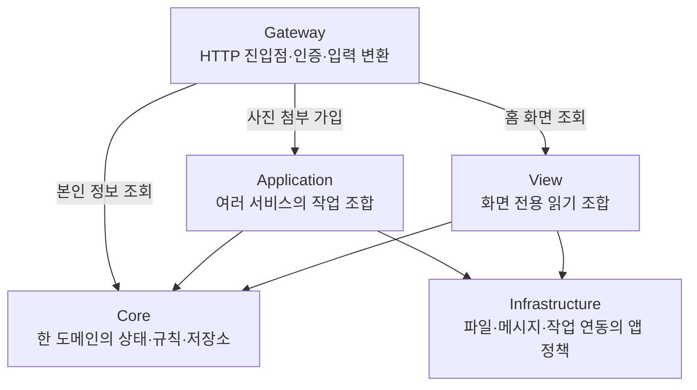

# API — 서비스 구성과 작성 규칙

## SoLA의 모듈 의존 방향

SoLA(Service-oriented Layered Architecture)에서는 한 도메인의 상태와 규칙을 소유하는 모듈에 Service·Repository·모델·DTO를 함께 둔다.

의존은 `Gateway → View → Application → Core → Infrastructure` 순서에서 아래쪽으로 향한다. 필요한 하위 계층을 직접 쓸 수 있다. 같은 계층의 두 도메인이 협력해야 하면 상위 계층에서 조합해 순환 의존을 피한다.



### 어디에 책임을 둘까

- **본인 정보 조회**에서 Gateway는 인증된 사용자의 ID로 `this.usersService.getMany([req.user.sub])`를 호출한다. 계정 정보는 사용자 도메인 하나가 소유하므로 Core 호출만으로 응답을 만들 수 있다. 이메일 중복처럼 다른 진입점에서도 지켜야 할 계정 규칙은 사용자 모듈에서 판단한다. [사용자 API](src/services/gateway/users.http-controller.ts) · [사용자 저장소](src/services/core/users/users.repository.ts)
- **사진 첨부 가입**은 계정 생성과 사진 소유권 등록이 함께 성공해야 하므로 Application에 둔다. `UserRegistrationService.register`는 업로드 완료를 확인한 뒤 Core의 계정 생성과 Infrastructure의 소유권 등록을 한 DB 트랜잭션으로 묶는다. 같은 사진으로 두 사람이 가입해도 한 계정만 소유권을 얻는다. [가입 서비스](src/services/application/user-registration/user-registration.service.ts) · [동시 가입과 롤백 테스트](src/__tests__/application/user-registration.spec.ts)
- **홈 화면 조회**는 화면에 필요한 계정 정보와 사진 다운로드 URL을 조합하므로 View에 둔다. 상태 변경이 필요하면 Core나 Application의 유스케이스로 정의한다. [홈 화면 조회](src/services/view/web/home/home-view.service.ts)

Infrastructure에는 업로드 완료 판정·소유권 부여처럼 외부 시스템을 사용하는 **이 앱의 정책**을 둔다. S3 요청 서명처럼 여러 앱이 그대로 쓸 SDK 연동은 common이 맡는다. [자산 서비스](src/services/infrastructure/assets/assets.service.ts) · [공유 패키지의 책임](../../libs/README.md#2-sdk-연결과-호출은-common에서-구현한다)

### Gateway와 모듈 공개 진입점

Gateway의 HTTP 컨트롤러는 `AppModule`에 등록한다. 사용자 컨트롤러를 `UsersModule`에 등록하면 가입 서비스를 쓰기 위해 `Users → UserRegistration → Users` 순환 의존이 생긴다. [사용자 컨트롤러](src/services/gateway/users.http-controller.ts) · [앱 모듈 조립](src/app.module.ts)

다른 모듈에는 `index.ts`로 필요한 항목만 공개한다. 작업 모듈은 `export { TextJobWorkflow } from './worker.js'`로 앱 조립에 필요한 workflow 정의를 내보낸다. 같은 모듈 안에서는 상대 경로를 사용한다. 자신을 다시 내보내는 진입점을 거치면 모듈 내부에서도 순환 참조가 생길 수 있다. [작업 모듈의 공개 진입점](src/services/infrastructure/job-demo/index.ts)

루트에서 `pnpm run lint:code`를 실행하면 계층 역참조와 다른 모듈의 비공개 파일 import를 검사한다. [의존 방향 검사 설정](../../oxlint.config.mts)

## 데이터와 서비스 계약

모듈은 자신의 컬렉션을 읽고 쓰며 다른 모듈의 데이터는 공개 서비스를 통해 다룬다. 쿼리·인덱스와 고유 키 충돌을 도메인 오류로 바꾸는 책임은 Repository에 둔다. 여러 Repository의 쓰기를 묶을 때는 같은 트랜잭션 context를 전달한다. [저장소와 트랜잭션 계약](../../libs/README.md#3-저장소-id와-트랜잭션)

Core 서비스는 `UsersService`처럼 엔티티 집합으로, Application 서비스는 `UserRegistrationService`처럼 유스케이스로 이름 짓는다. 조회 조건은 `findForAuthentication({ email })`처럼 객체로 받고, 이름에는 반환 목적을 드러낸다. 일반 조회·삭제는 단건도 다건 서비스 메서드를 사용하므로 호출 대상이 늘어도 같은 계약을 쓸 수 있다. [사용자 서비스](src/services/core/users/users.service.ts) · [인증용 조회](src/services/core/users/users.repository.ts)

| 조회 메서드를 지을 때   | 호출자가 기대하는 결과                           |
| ----------------------- | ------------------------------------------------ |
| `find` / `findMany`     | 대상이 없으면 null / 찾은 대상만 배열로 반환     |
| `get` / `getMany`       | 요청한 대상 중 하나라도 없으면 NotFoundException |
| `search` / `searchPage` | 조건 검색 결과 / 페이지 정보가 포함된 결과       |

요청·응답 DTO는 DB 모델과 구분하고 Zod 스키마에서 타입을 추론한다. 스키마는 `Schema`, 타입은 `Dto`로 끝낸다. JSON 본문은 선언한 타입으로 받고 숫자 쿼리나 날짜처럼 필요한 필드만 변환한다. 수정 요청이 생략한 필드는 기존 값을 유지하며 `null`은 모델이 허용할 때만 받는다. [생성 스키마](src/services/core/users/dtos/create-user.dto.ts) · [수정 스키마와 타입](src/services/core/users/dtos/update-user.dto.ts) · [JSON 값 복원](../../libs/README.md#4-json과-dto-복원)

```ts
export const UpdateUserSchema = CreateUserSchema.partial()
export type UpdateUserDto = z.infer<typeof UpdateUserSchema>
```

### 이벤트와 비동기 작업의 완료 기준

`POST /event-demo/messages`는 JetStream이 메시지를 접수하면 202와 `id`를 반환한다. 발행한 사용자의 열린 SSE 연결로 같은 `id`의 이벤트를 보낸다. 메시지가 재전달되면 그 ID가 다시 올 수 있다. `POST /job-demo/jobs`는 Restate가 작업을 접수하면 202와 `jobId`를 반환한다. 호출자가 연결을 닫아도 나중에 `GET /job-demo/jobs/{jobId}`로 본인 작업의 진행 상태와 저장된 결과를 조회할 수 있다. [이벤트 발행과 수신 테스트](src/__tests__/infrastructure/event-demo.spec.ts) · [작업 제출·조회 예제](api-docs/job-demo.spec)

## 오류와 실행 설정

Core·Application도 NestJS DI와 `HttpException`을 사용한다. 예상한 오류는 해당 모듈의 `errors.ts`에 정의하고 조건을 판단한 곳에서 던진다. 클라이언트가 구분할 4xx 응답에는 `code`를 넣고, 5xx 내부 원인은 서버 로그에 남긴다. HTTP 로그는 stdout/stderr에 ECS JSON으로 출력하며 요청·응답 본문과 쿼리를 제외한다. [HTTP 예외 로깅 테스트](../../libs/common/src/logger/__tests__/exception-logger.filter.spec.ts)

환경마다 달라지는 값은 부팅할 때 검증하고 화면 조회 개수 같은 고정값은 사용하는 코드에 둔다. 배포할 때는 번들 밖의 common 등 런타임 의존성도 함께 설치한다. 준비 상태에는 이벤트 전달도 포함되므로 NATS에 연결되어 있어도 JetStream 소비자가 멈추면 `/health`가 503을 반환한다. [컨테이너 빌드](Dockerfile) · [기동·장애 응답 테스트](src/__tests__/health.spec.ts)

## 테스트

API 통합 테스트는 `#test-helpers`의 `createAppTestContext()`로 실제 Nest 모듈과 인프라를 연결한다. DB·버킷은 worker마다, `PROJECT_ID`는 테스트마다 다르므로 키 접두어·subject·workflow 이름은 주입된 설정에서 얻는다. 데이터 준비·조회·장애 주입 함수는 해당 `*.utils.ts`에 둔다. 경로 접두어 같은 HTTP 설정은 `createAppTestContext({ configureApp })`에서 경로 등록 전에 적용한다. [공통 훅](vitest.setup.ts) · [테스트 작성 규칙](../../AGENTS.md#테스트는-한-행동의-결과를-검증한다)

테스트가 끝나면 `await fix.teardown()`으로 앱을 닫는다. 제출한 작업의 완료를 확인할 수 없으면 테스트용 Restate 배포를 보존하고 오류를 전달한다. [테스트 앱 생성·정리](src/__tests__/helpers/create-app-test-context.ts) · [비동기 작업 테스트](src/__tests__/infrastructure/job-demo.spec.ts)

### 실행 가능한 API 문서

외부에 전달할 예제 묶음은 저장소 루트에서 `bash apps/api/pack-api-docs.sh > /tmp/api-docs.tar.gz`로 만든다. 로컬에서 받은 응답과 실행 로그는 압축에서 제외한다. [패키징 스크립트](pack-api-docs.sh)

받은 사람은 Bash·curl·jq가 설치된 Linux 환경에서 압축을 푼다. 그 폴더에서 아래 주소를 대상 API 주소로 바꿔 실행한다. `users.spec`를 생략하면 전체 예제를 실행한다. 사진 예제는 발급받은 S3 주소로 직접 업로드하므로 실행 환경에서 그 주소에도 접속할 수 있어야 한다. [주소 지정 예시](api-docs/run.cfg) · [회원가입 요청과 기대 응답](api-docs/users.spec)

```bash
SERVER_URL=https://api.example.com bash run.sh users.spec
```

최근 실행의 요청별 기대·실제 HTTP 상태는 `_output/docs/summary.md`에서 확인한다. 상태가 다르거나 연결이 끊기면 실행기가 실패 코드로 종료한다.
