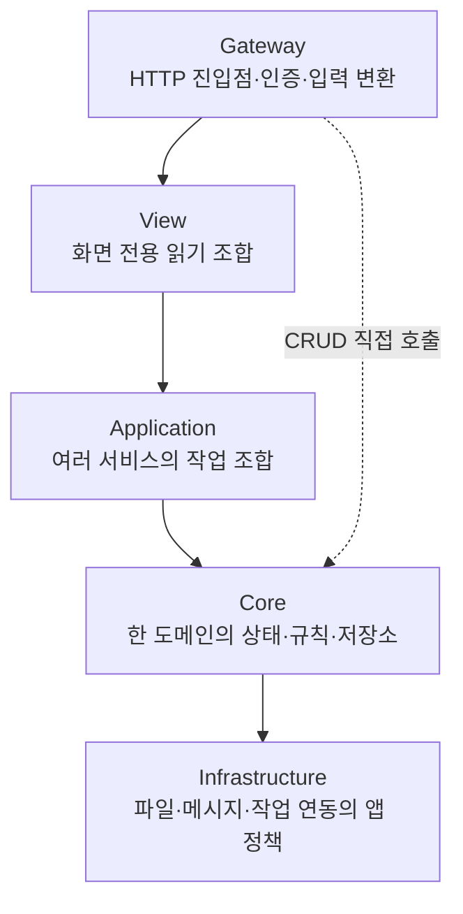

# API — 서비스 구성과 작성 규칙

API의 동작과 보장은 [앱 가이드](../README.md)에, 실행 명령은 [루트 README](../../README.md#실행과-검증)에 있다.

## 서비스 구성

| 서비스                                                                 | 계층           | 책임                                    |
| ---------------------------------------------------------------------- | -------------- | --------------------------------------- |
| [UsersService](src/services/core/users/)                               | Core           | 사용자 저장·조회와 인증                 |
| [UserRegistrationService](src/services/application/user-registration/) | Application    | 선택한 사진과 계정을 함께 등록          |
| [WebHomeViewService](src/services/view/web/home/)                      | View           | 로그인한 사용자 정보와 사진 URL 조합    |
| [AssetsService](src/services/infrastructure/assets/)                   | Infrastructure | 파일 업로드·소유권·삭제                 |
| [EventDemoService](src/services/infrastructure/event-demo/)            | Infrastructure | JetStream 메시지 발행·소비와 SSE 전달   |
| [JobDemoService](src/services/infrastructure/job-demo/)                | Infrastructure | Restate 문자열 변환 작업 접수·결과 조회 |

## SoLA의 모듈 의존 방향

모듈은 하위 계층에만 의존하며 같은 계층의 다른 모듈을 직접 참조하지 않는다. 여러 모듈의 조합은 상위 계층이 맡는다. 각 모듈 내부에는 필요한 Service·Repository·모델·DTO를 함께 둔다.

중간 계층을 모두 거칠 필요는 없다. 본인 조회·수정은 Gateway → Core로 충분하다. UserRegistration은 Users와 Assets를 조합하므로 Application에, EventDemo·JobDemo는 다른 도메인의 조합 없이 기술 연동을 담당하므로 Infrastructure에 둔다.

View는 화면 응답과 항목의 순서·개수를 결정하는 읽기 전용 계층이다. Users는 사진 ID만 보관하고 WebHomeView가 필요한 URL을 조회하므로, URL이 필요 없는 호출에 자산 조회가 붙지 않는다. 상태 변경·transaction은 View에 두지 않으며 Application·Core가 View를 참조하거나 화면 때문에 도메인 API의 목적을 바꾸지 않는다.

`internal/`·`worker/`는 모듈 내부 폴더다. 계층과 import 방향은 lint가, View의 읽기 전용 동작은 리뷰가 확인한다.

### Gateway와 모듈 공개 진입점

컨트롤러는 `services/gateway`에 두고 `AppModule`에 등록한다. `UsersHttpController`가 가입은 UserRegistration에, 로그인·본인 조회·수정은 Users에 맡겨 사용자 HTTP API를 한곳에서 읽을 수 있게 한다. 이를 UsersModule에 넣으면 Users → UserRegistration → Users 순환이 생긴다. 다른 모듈에서 UsersModule을 import해도 HTTP 경로는 등록되지 않는다.

다른 모듈은 공개 `index.ts`로만 참조한다. `internal/`·`worker/`는 공개하지 않고 앱 조립에 필요한 workflow 정의 등만 export한다. 모듈 내부·부모 참조는 상대 import를 사용하며 자신을 다시 export하는 진입점은 참조하지 않는다. 테스트도 공개 진입점을 사용하되 비공개 구현 자체를 검사해야 할 때만 예외를 둔다.

SDK 호출과 peer dependency는 [공유 패키지](../../libs/README.md#2-sdk-연결과-호출은-common에서-구현한다), ESM import와 타입 표기는 [TypeScript 규칙](../../libs/README.md#7-typescript-작성-규칙)을 따른다.

## 데이터와 트랜잭션

모듈은 자기 collection만 읽고 쓰며 다른 모듈은 공개 서비스로 호출한다. Repository는 쿼리·인덱스와 DB 오류 변환을, common은 연결·드라이버 실행을 맡는다. 서비스는 MongoDB 오류 번호나 ClientSession을 다루지 않는다.

MongoDB는 문서 모델과 공식 driver 사용을 보여 주기 위한 선택이다. 다른 DB에서도 모듈 구조는 유지할 수 있지만 쿼리·동시성 보장까지 자동으로 바뀌지는 않는다. unique index는 중복 가입을, 조건부 갱신과 transaction은 사진 소유권 경쟁을 제어한다. 다중 문서 transaction을 사용하므로 개발 환경도 Replica Set이다.

여러 모듈을 묶을 transaction은 Application이 결정한다. `TransactionContext`는 콜백 안에서만 유효하고 common이 세션을 생성·종료한다. 콜백은 재실행될 수 있으므로 S3 쓰기나 메시지 발행을 넣지 않는다. ID 변환·쓰기 확인·페이지 조회의 일관성은 [저장소 계약](../../libs/README.md#3-저장소-id와-트랜잭션)을 따른다.

### DTO와 JSON

요청·응답과 JSON에서 복원할 데이터는 Zod 스키마로 정의하고 `z.infer`로 타입을 얻는다. 검증·복원에 같은 스키마를 쓰기 위한 선택이며 내부 DB 모델을 그대로 응답하지 않는다. 타입은 `Dto`, 스키마는 `Schema`로 끝낸다. [CreateUserSchema](src/services/core/users/dtos/create-user.dto.ts)처럼 동작과 대상을 이름에 드러낸다. JSON을 거치지 않는 내부 인자까지 스키마를 만들지는 않는다.

JSON 본문의 숫자·불리언·문자열은 선언한 타입으로 받고, 쿼리 숫자·날짜처럼 변환할 필드만 명시한다. 수정 필드 생략은 기존 값 유지이며 `null`은 모델이 허용할 때만 받는다. 달력 날짜는 `Temporal.PlainDate`, 시점은 `Temporal.Instant`로 구분하고 문자열 모양으로 추측하지 않는다. 직렬화·테스트·workflow 복원은 [JSON 계약](../../libs/README.md#4-json과-dto-복원)을 따른다.

## 서비스 이름과 조회 계약

Core는 엔티티 집합을 나타내는 `UsersService`, Application은 유스케이스를 나타내는 `UserRegistrationService`처럼 이름 짓는다. 단수·복수는 처리 개수가 아니라 책임을 구분한다. 조회 조건은 `find({ email })`처럼 객체로 받고 인증용 정보처럼 목적이 다르면 `findForAuthentication`으로 드러낸다. 단일 값 유틸까지 객체 인자로 바꾸지는 않는다.

| 이름                    | 계약                                             |
| ----------------------- | ------------------------------------------------ |
| `find` / `findMany`     | 없으면 null / 찾은 결과만 배열로 반환            |
| `get` / `getMany`       | 요청한 대상 중 하나라도 없으면 NotFoundException |
| `search` / `searchPage` | 조건 검색 / 페이지 정보를 포함한 검색            |

일반 서비스 조회·삭제는 `getMany`·`deleteMany`를 사용한다. HTTP에서 한 건을 처리해도 `[id]`로 호출하고 한 건만 반환한다. 나중에 여러 건을 호출해도 서비스 계약을 바꾸지 않기 위한 선택이다. 생성·수정·목적별 조회까지 일괄 API로 통일하지 않는다.

## 오류와 실행 설정

Core·Application도 NestJS DI와 `HttpException`을 사용한다. 예상한 실패는 해당 모듈의 `errors.ts`에 정의하고 조건을 판단한 코드에서 던진다. Repository는 고유 키 충돌 같은 DB 판정을 도메인 예외로 바꾸며 Gateway에서 같은 오류를 다시 변환하지 않는다. 구분할 4xx에는 `code`를, 5xx의 내부 원인은 응답 대신 서버 로그에 남긴다.

`config/`는 필수 env를 부팅 시 검증하고 `modules/`·`app.module.ts`는 연결·provider를 구성한다. `ConfigModule`은 `ignoreEnvFile: true`로 주입된 값만 사용한다. env 변경은 [개발 환경](../../.devcontainer/README.md#1-환경-변수-파일-변경-후-dev-container-재생성)을 따른다. 환경별 설정은 env에, 화면 조회 개수 같은 고정 정책은 관련 코드에 둔다. 내부 필수 값은 `ensure`·`Require.defined`, 필수 shell 변수는 `${VAR:?}`로 확인한다.

개발 watch는 TSC, production build는 Rspack을 사용한다. common 등 런타임 패키지는 번들에 넣지 않으므로 앱과 함께 별도로 배포한다. 독립 `scripts/`는 common 빌드 없이 실행하도록 SDK를 직접 사용할 수 있다.

활성화된 로그는 ECS JSON 한 줄로 stdout/stderr에 출력하며 요청·응답 본문과 query는 포함하지 않는다. 검증 스택의 로그 회전은 Docker가 맡고 앱은 별도 로그 파일을 만들지 않는다. 장기 저장·검색은 배포 환경에서 구성한다.

## 테스트

`src/__tests__`는 실제 Nest 모듈과 MongoDB·Redis·S3·NATS·Restate에 연결한다. 독립 계산·변환은 직접 검증할 수 있으나 단순 위임마다 단위 테스트를 만들지는 않는다. 작성 규칙과 새 파일 추가 조건은 [테스트 가이드](../../tests/README.md#테스트는-한-행동의-결과를-검증한다)와 [작업 지침](../../AGENTS.md#5-요구사항만-최소한으로-수행한다)을 따른다.

`createAppTestContext`와 공통 훅이 앱을 준비·정리하고 데이터 준비·상태 조회·장애 주입 함수는 대응하는 `*.utils.ts`에 둔다. worker별 DB·bucket과 테스트별 `PROJECT_ID`로 자원을 나눈다. prefix·subject·workflow 이름은 모듈 import 시점의 `process.env`가 아니라 provider에 주입된 설정으로 정한다.

workflow 테스트는 `enableRestate: true`로 endpoint를 등록하고 작업 종료 후 제거한다. 다른 테스트의 workflow 제출은 거절한다. 202 접수·DB 반영·SSE 수신은 별도 결과이므로 검증할 작업의 완료를 기다리고 결과를 조회한다. SSE 준비와 정리는 [테스트 client 계약](../../libs/README.md#5-sse-이벤트를-받는-테스트-작성)을 따른다.

### 실행 가능한 API 문서

[api-docs/](api-docs/)의 bash·curl spec은 주요 성공·실패 흐름을 실행해 문서와 동작을 함께 확인한다. 전체 API 카탈로그·SDK 생성이나 SSE·세부 장애 테스트까지 대신하지 않는다. `TEST`는 설명·기대 상태를 가진 문서 항목이고 `SETUP`은 조건을 준비하는 요청이다.

`common.fixture`의 `login_user`는 이후 요청에 인증 헤더를 넣고 `as_guest`는 해제한다. 명시한 Authorization이 우선한다. 직접 실행은 api-docs의 `.env`, 검증 스택은 runner의 `SERVER_URL`을 사용한다. 명령과 응답 로그 위치는 [루트 실행 안내](../../README.md#실행과-검증)에 있다.
