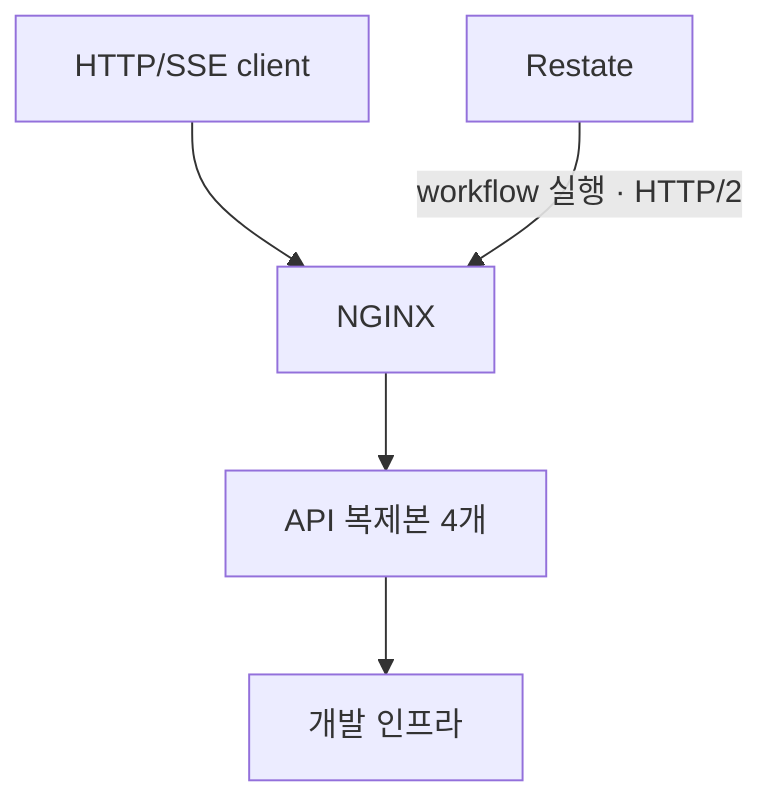

# tests/ — 다중 복제본·브라우저·성능 검증

API·라이브러리의 기본 동작은 각 workspace에서 검증한다. 이 폴더는 프로세스 간 경쟁, production build의 브라우저 연결, 같은 조건의 성능 차이를 확인한다. API 통합 테스트의 모든 실패 조건이나 화면별 단위 테스트를 다시 작성하지 않는다. 명령·결과 위치는 [루트 실행 안내](../README.md#실행과-검증)에 있다.

## 검증 범위

API와 common의 line·branch·function 커버리지는 100%를 요구한다. 새 분기가 실행되지 않아도 기존 점수로 통과하는 일을 막기 위한 기준이며, 단언의 의미나 동시 요청의 안전성까지 증명하지는 않는다. 실행되지 않는 방어 분기는 구조를 검토하고 커버리지 제외가 필요하면 근거를 남긴다.

| 검사            | 확인하는 범위                                     |
| --------------- | ------------------------------------------------- |
| API 통합 테스트 | 실제 모듈·인프라의 동작과 실패 조건               |
| 브라우저 E2E    | 화면·BFF·쿠키·API의 연결                          |
| Race            | API 복제본 4개 사이의 HTTP/SSE 경쟁과 복제본 장애 |
| 반복 CI         | 간헐적인 실패                                     |

테스트 수보다 확인하는 동작과 실행 비용을 기준으로 범위를 판단한다.

## 테스트는 한 행동의 결과를 검증한다

코드 식별자는 영어로, 조건·결과는 한국어로 쓴다. `describe`와 `it`을 이어 읽었을 때 준비 상태·행동·기대 결과가 드러나야 한다.

```text
describe('POST /users')
└─ describe('사용자가 존재하면')
   ├─ beforeEach: 기존 사용자를 준비한다
   └─ it('그 사용자의 이메일로 가입을 요청하면 409를 반환한다')
```

- 실행 전에 정해지는 데이터·환경·입력·헤더·본문·인증은 `describe`의 조건과 `beforeEach`의 준비로 둔다. 한 테스트만 쓰는 조건도 동일하다. `describe`에서 실행할 행동을 가정하지 않고 `it`에서 호출과 결과를 확인한다. HTTP 응답은 “반환한다”, 서비스 예외는 “던진다”로 구분한다.
- 제목에는 관찰할 결과를 쓰고 테스트 구성·관측 방법·불필요한 내부 용어를 나열하지 않는다. 기술명·필드명은 구분에 필요할 때만 쓴다. 매개변수 사례도 `실패=true`나 객체 출력 대신 의미 있는 조건 이름을 붙인다.
- 독립 입력 조건은 `describe.each`, 같은 준비 상태에서 호출 인자·단언 구조가 같은 메서드 비교는 `it.each`로 묶을 수 있다. 사례마다 다른 실행 순서·검증을 고르거나 실행 함수를 표에 숨겨야 하면 테스트를 나눈다. 설명 문자열을 바꿔도 실행 동작은 바뀌지 않아야 한다.
- 같은 부모에서 같은 상태를 준비하는 `describe`는 합친다. 공통 준비는 훅에 두되 단언 중복을 줄이려고 독립 시나리오를 합치지 않는다.
- **한 행동의 응답과 DB 반영은 같은 테스트에서 확인할 수 있다.** 독립 조건·실패 원인을 섞지 않고 가능하면 공개 조회로 결과를 확인한다. 완료를 주장하면서 처리 중 상태만 보거나, 필요한 결과가 비어 있어도 통과하는 단언을 만들지 않는다.
- 실제 연결의 장애 주입·시간 제어·동시 실행 조율에는 spy를 쓸 수 있다. insert를 mock으로 생략하면 transaction rollback을 검증한 것이 아니다. `sendRaw()`의 상태는 호출자가 검사한다. 제목은 실제 단언 범위만 설명하고 단일 프로세스 결과를 분산 보장으로 확대하지 않는다.
- 테스트가 만든 앱·연결·작업은 테스트가 종료한다. 완료는 Promise나 프로토콜 상태로 확인하며 sleep으로 대신하지 않는다. TTL 만료 자체를 검증할 때는 기다릴 수 있다. 상태 공유는 의도한 순차 시나리오일 때 명시하며 준비 비용 때문에 테스트를 서로 의존하게 만들지 않는다.

API의 context·공통 훅·보조 함수 배치는 [API 테스트 안내](../apps/api/README.md#테스트)를 따른다.

## 테스트용 API 실행과 종료

[API Compose](api/compose.yml)는 API 문서·race·benchmark용 API 복제본 4개와 NGINX를 실행한다. 분리된 프로세스가 Redis·DB·NATS로 협력하는지 확인하며, 기존 [개발 인프라](../infra/README.md)를 공유한다.



환경 변수는 [Dev Container의 주입 방식](../.devcontainer/README.md#1-환경-변수-파일-변경-후-dev-container-재생성)을 따른다. 각 검증이 사용자를 직접 가입시키고 스택 종료는 API·NGINX만 정리한다. DB·bucket·journal과 benchmark 데이터는 남으며 삭제는 infra reset으로 한다.

API 문서·benchmark·web 실행기는 검증 실패의 종료 코드를 반환하고, 검증이 성공해도 정리가 실패하면 실패로 끝난다. API 종료를 가리지 않도록 자동 restart 정책을 두지 않으며 chaos는 kill·start로 제어한다.

운영 배포에 필요한 TLS·secret 관리·백업·관측·프론트엔드 배포·무중단 revision 전환은 이 검증 스택에 포함하지 않는다.

## Race의 보장과 한계

race는 내부 클래스를 호출하지 않고 HTTP/SSE 결과를 확인한다. 사진·계정 transaction, 메시지 전달 실패, 작업 재시도는 API 통합 테스트에서 검증한다.

| 시나리오           | 확인하는 결과                                                          |
| ------------------ | ---------------------------------------------------------------------- |
| `user-signup-race` | 동일 이메일의 동시 가입은 성공 하나와 충돌 응답으로 끝남               |
| `sse-fanout-race`  | 여러 복제본의 SSE 연결 모두에 발행한 메시지 전달                       |
| `jwt-refresh-race` | 같은 refresh token의 동시 교체는 하나만 성공하고 새 토큰으로 세션 유지 |
| `replica-chaos`    | 가입 중 복제본을 kill·start하며 오류율과 복구 후 응답 복제본 확인      |

`x-replica-id`는 API hostname이며 고정된 API 형식이 아니다. HTTP 요청이 keep-alive로 한 복제본에 고정되지 않게 한다. 가입·refresh는 회차 전체에서 두 복제본 이상이 응답했는지 확인하지만, **같은 이메일·토큰의 경쟁 요청이 여러 복제본에 분산됐는지는 확인하지 않는다.** SSE는 구독의 복제본 분산과 각 연결의 수신을 확인한다. Restate 서버 자체의 재시작은 별도 [journal 복구 테스트](../infra/tests/restate-journal-recovery.js)에서 검증한다.

HTTP·프록시의 대기 기한은 DB·workflow 저장 확인 기한보다 길게 둔다. 장시간 race는 회차 시작 전에 토큰 갱신을 끝내며 경쟁 중 인증 실패는 테스트 실패다. 실패 시 스택을 정리하기 전에 컨테이너 로그·상태·자원 사용량과 MongoDB 복제 상태를 수집한다.

## Restate 등록과 포트

API·NGINX의 health가 정상이어도 workflow 등록은 별도다. 실행기는 준비 후 `restate-register`로 고정 `http://nginx:9080`을 등록한다. HTTP·Restate 포트를 바꾸면 env·[NGINX upstream](api/nginx.conf)·Compose 등록 URI를 함께 맞춘다.

등록은 `force: false`이므로 같은 URI의 코드·manifest만 바꿔서는 기존 배포 정의가 교체되지 않는다. 보존할 작업이 없는 개발 환경은 journal을 삭제하는 infra reset으로 초기화한다. 실행을 보존해야 할 때는 [revision 배포 조건](../apps/README.md#진행-중인-작업을-보존하는-배포)을 따른다.

## 브라우저 E2E

production build한 web·API를 Compose로 실행하고 Dev Container의 Playwright·Chromium으로 접속한다. 일반 E2E는 호스트에 포트를 공개하지 않고 Docker 네트워크로 연결한다. 사진 첨부 가입·본인 조회와 쿠키 전달·갱신·로그아웃, 사진 실패 시 가입 중단을 검증한다. 브라우저 설치는 [개발 환경](../.devcontainer/README.md#3-시작-순서와-데이터-초기화)이 관리한다.

테스트는 내부 HTTP 때문에 Secure 쿠키를 끄고 전달 헤더 신뢰를 켠다. 실제 edge의 IP 헤더 재구성이나 BFF·API 직접 접근 차단까지 검증하지는 않으므로 [BFF의 운영 조건](../apps/README.md#web과-bff)과 구분한다. 실행기는 `${COMPOSE_PROJECT_NAME}-web`의 앱만 종료한다.

## Benchmark와 반복 CI

benchmark는 같은 머신·이미지·데이터에서 본인 정보 읽기·수정·혼합 부하를 비교한다. 정상 상태 코드인지 먼저 확인한 뒤 처리량·p95·p99를 비교하며 운영 SLA를 보장하지 않는다.

각 가상 사용자(VU)는 가입·로그인 후 측정하고 장시간 실행 중에는 만료 전에 토큰을 갱신한다. 인증 실패는 실행 전체의 실패다. 인증 요청은 본인 정보의 지연·개수 지표에서 제외하지만 서버 자원을 사용하므로 비교할 인증 조건도 맞춰야 한다.

AtoZ는 필수 기본 회귀이며 Stability·API Race는 간헐 실패를 찾는 반복 검사다. Stability의 반복에서는 커버리지를 수집하지 않지만 AtoZ의 100% 기준은 유지한다. 횟수·일정은 [CI 설정](../.github/workflows/)에서 관리한다.
